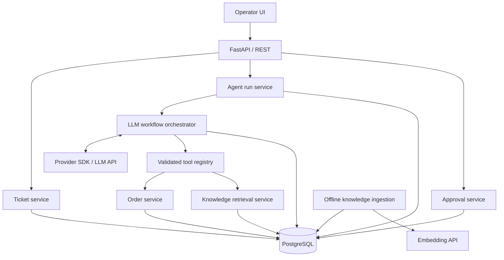

# Architecture — v0.1

**Status:** Proposed (M0-04)  
**Context:** [PRD](PRD.md), [domain model](domain-model.md), [REST contracts](api-contracts.md)

## Quality goals

1. Demonstrate reliable LLM integration **inside** a conventional Python application.
2. Prevent any model-generated instruction from bypassing backend authorization or business rules.
3. Keep the solution testable without paid model calls; add measurable online evaluations.
4. Favor a small modular monolith over microservices or infrastructure copied from unrelated projects.

## Logical architecture

**Module boundaries:** API validates requests and maps errors; application services coordinate use cases; domain services enforce business rules; agent orchestration chooses *read-only* tools and composes validated drafts; infrastructure adapters communicate with Postgres and external model/embedding APIs. A model never receives DB credentials.

## Analysis flow (M2–M3)

1. Operator requests analysis of an existing ticket through `POST /api/v1/tickets/{ticket_id}/analyses`.
2. Backend loads the ticket and its trusted customer/order scope, creates an `AgentRun` and prepares a bounded LLM request.
3. Model may request **only** `get_order_status` or `search_knowledge_base`.
4. Backend validates arguments and permissions, executes read-only tools and returns bounded results.
5. Model returns an `AgentResponse` with evidence references; backend validates its schema **and** checks that refs belong to observations available in this run.
6. Backend persists the draft, tool-call metadata and optional `ActionProposal`; returns completed analysis.
7. If an upstream failure occurs, mark the run `FAILED` where possible and return a controlled API error; never create a business-side escalation from a partial result.

**Bounded execution:** per-call timeout, total analysis deadline, max tool calls, max output tokens and no unbounded retry loops. Exact thresholds belong to M2 configuration/testing.

## Approval flow (separate request, no LLM execution)

1. Operator reviews the proposal. A demo server-side identity represents the operator in MVP (not production authentication).
2. `POST /api/v1/action-proposals/{proposal_id}/approve` starts a DB transaction.
3. Lock/read proposal, ticket and required business state; reject stale or ineligible requests. Check ticket/order still satisfy escalation rules.
4. Update ticket status, proposal status and audit event atomically, then commit.
5. Duplicate approval should return the existing executed result without applying the change again. Rejecting an executed proposal conflicts.

Do not keep the original analysis HTTP request open while waiting for approval. This design does **not** depend on LangGraph interrupt/resume. We can revisit graph checkpointing at M3, without making checkpoints the source of truth for business writes.

## Trust and security boundaries

- **Trusted:** application-generated ticket context, DB policies, approved action implementation.
- **Untrusted:** ticket message, retrieved knowledge text, model-generated arguments/output.
- All order reads are checked against the *ticket context* on the server, not just a model-provided `order_id`.
- Store policies are evidence, not system/developer instructions. Their content cannot grant permissions.
- Validate output syntax, allowlisted evidence references and business eligibility separately.
- Never log API secrets, provider credentials or full raw request bodies by default.
- MVP operator is a local/demo identity; public deployment requires actual authN/authZ before exposure.

## Runtime / infrastructure

- Locally: FastAPI, PostgreSQL with pgvector, Docker Compose; ingestion command or fixture data setup.
- Database schema and migrations: SQLAlchemy 2.x + Alembic.
- Tests: pytest, deterministic LLM stubs in CI, optional real-model evaluation run.
- Deployment: not needed to prove MVP; revisit for public demo.
- UI: thin operator-facing view after reliable backend implementation.

## Open design questions (resolve during M1–M3)

- Model/embedding model versions and strict token/cost caps (pricing is version-dependent).
- Whether LangGraph's durable checkpoints simplify actual flows enough to justify adoption.
- Embedding ingestion/versioning and retrieval relevance threshold, based on evaluation data.
- Whether synchronous analysis remains suitable once empirical latency is measured.
